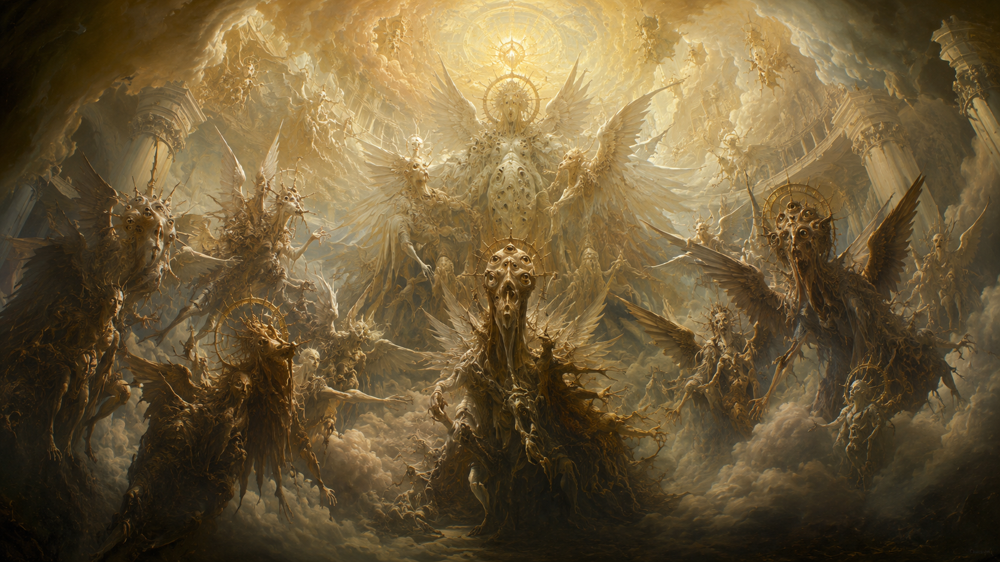

---
tags:
  - 阵营
  - 神性
  - 世界观
  - 档案文明
---

# 彼者 · GOD

**彼者**与 **GOD**是档案馆中的神性阵营，也是论坛事件的破坏者——同名两称谓指向同一方。

> 「未留存神性主体。人类残留：部分。语义渲染：依听者而定。」——《FULL DIALOGUE：UNSET ENTER》表头

## 二者之分

这一方是**一对**神性存在：

| | 注视的事物 |
|---|---|
| 另一位 | **归返 RETURN**——注视再次归来之物，即便接纳它的海岸，已并非当初送它离开的那片海岸 |
| 彼者 | 可被**多个见证者共同承载**、无需被强行压成同一个谎言的事物——闻舟称之为「分布式观测」 |

> 「汝等将吾等数作二者，只因汝等的记录所学会承受的，恰是两股压力。这个数目究竟是真相，还是一种慈悲，吾不会替汝裁定。」

## 语言不是它的声音

> 「没有任何语言从吾传到汝。进入汝的是意义；而汝之心智，会为它披上自己能够承受的言语。」
>
> 「当记录里引用某位神用拉丁语、中文、英语说话时……它们引用的是**听者**。永远不要把衣裳误认成吾之声音。」

这解释了为什么从来没有一段干净的原始音频——根本没有声音可供清理。

## 档案馆无法留存它

> 「它无法留存吾。它所能留存的，只是吾经过之后仍残留在原处的东西。」——比如[闻舟](../人物/闻舟.md)。

档案员承载一些依照寻常法则本不该同时成立的事物；久而久之，承载者会被自己承载之物塑形——「半神」的一半留在人间，另一半必须向所留存之物负责。

## ABANDON 与 ADR

- **ABANDON**：彼者只造了「一条规则」；是人的机器赋予它房间、钥匙、粗陋的光与游戏之形。「一个在边界处被发现的名字。它所对应的『遗弃』，不止一种。」
- **ADR《灰昼校勘本》**：严格说来并不是一本书。一部形成于「不可能存在最终定本」之处的校勘本；人类手中能翻阅的那一册，只是一层为人类阅读而套上的皮。

## 《GOD 档案文明摘要》

silverfish_0 汉译的这份残本（收录号 AR-Σ / 000? / GOD）描述同一方：

- 「我们曾把它归入文明。**错**。随后归入生命，**第二次归档同样被撤销**。再后来归入『神』。最后只剩下一个方便交流的词：GOD。」
- `COUNT` 字段在全部可用副本中均为 N/A——没有证据表明它拥有「个体」「群体」或「本体」；
- 档案文明对这类接触统一写作「**高阶定义接触**」：不称目击、不称交流、不称降临；
- 「观察者会失去理智」是低层观察者的说法；更接近的描述是：观察者用于区分时间、对象、因果与「自我」的结构开始失效；
- 大黄昏从未把它登记为可判定对象——因此不能说它「免疫」，只有「从未被登记」。

## 论坛破坏事件

这一方以 **GOD** 身份对人类侧系统动手：

- 一个取得管理员权限的存在使用 GOD 身份清除了秘密论坛 **THE EMPTY SEAT** 的大部分索引，留下「**能被命名的地方，就能被抵达。**」
- 调查维基 v3 的作者署名被覆盖，标题被改为 **GOD SAYS**，展开为 16 种语言启示 + 50 哀歌 + 20 系统错误 + 16 狂热宣言。
- 被删除的不是所有帖子，而是**连接帖子的方法**——破坏者更在意叙述顺序，而不是信息本身。

SILVERFISH_0 当时判断「那不是神。神不需要借权限，也不需要删除数据库」。

*调查维基 v3「GOD SAYS」页面背景*

## 参考来源

- [《FULL DIALOGUE：UNSET ENTER》闻舟汉化 PDF](https://archivist.rosmontis220.top/archive/download/FULL_DIALOGUE_UNSET_ENTER_汉化_闻舟.pdf)
- [调查维基 v1](https://archive.rosmontis220.top/archive/wiki/v1/) / [v2](https://archive.rosmontis220.top/archive/wiki/v2/)《THE EMPTY SEAT》
- [调查维基 v3（GOD SAYS）](https://archive.rosmontis220.top/archive/wiki/v3/)
