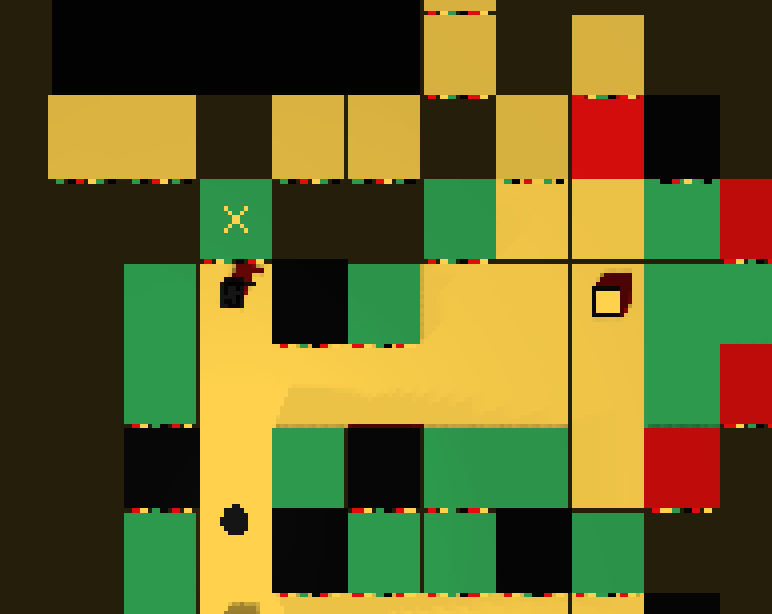
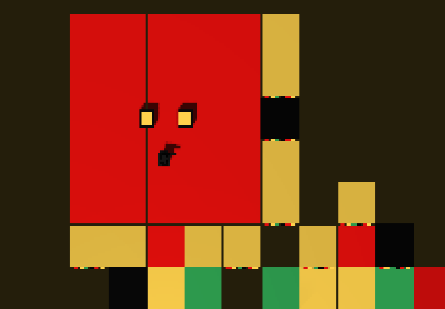
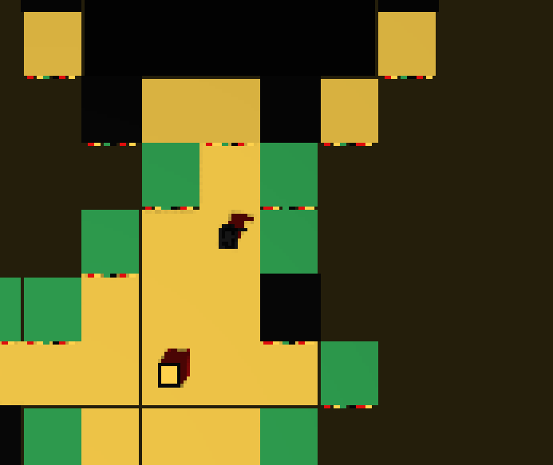
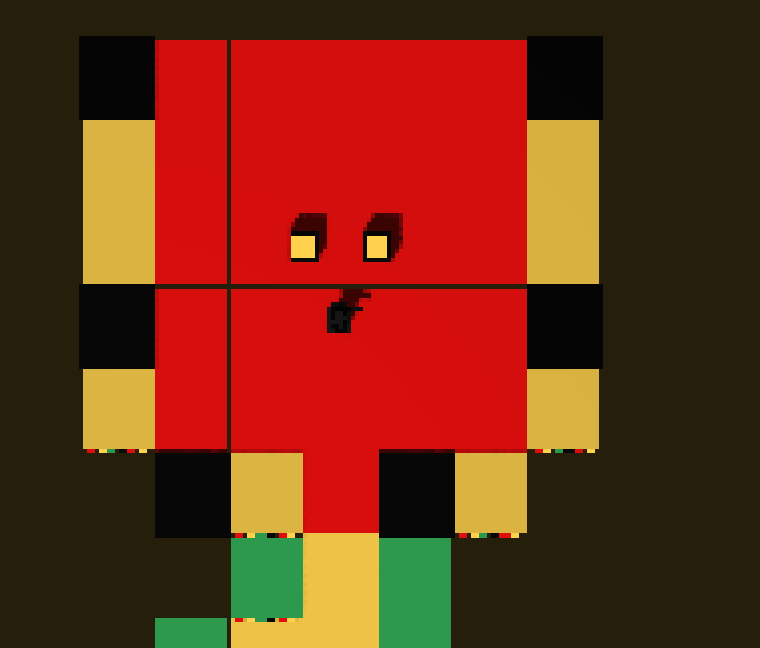
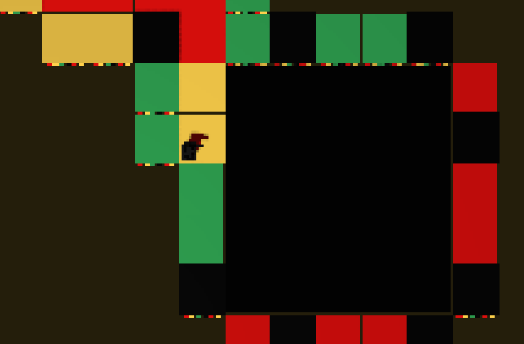
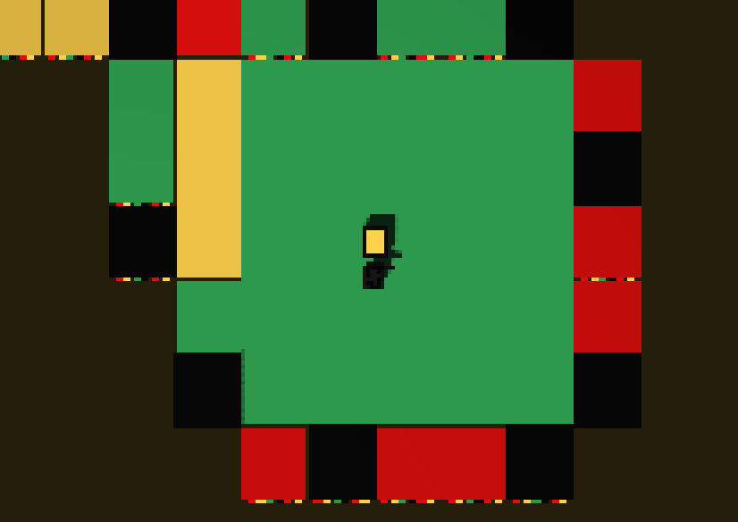

---
tags:
  - 小游戏三部曲
  - REVIEW
  - 解谜
---

# 隐藏房间

REVIEW 的隐藏房间——在以下三个位置开枪可得到隐藏文本：

**第一层 · 对应位置（向上开枪）**

**开枪后：**

**第二层 · 向上的楼梯上方（向上开枪）**

**开枪后：**

**第三层 · 右下角（向下开枪，逆时针转圈）**

**开枪后：**

> 第四章开始会出现石头——第三结局前置。

隐藏文本共 **80 条**（4 关 × 4 房间 × 5 位置），逐字收录在[隐藏文本](隐藏文本.md)。

## 参考来源

- [腾讯文档《小游戏三部曲解谜》](https://docs.qq.com/sheet/DVXB2ZmR1emZEVkhD)（隐藏房间三处开枪位置）
